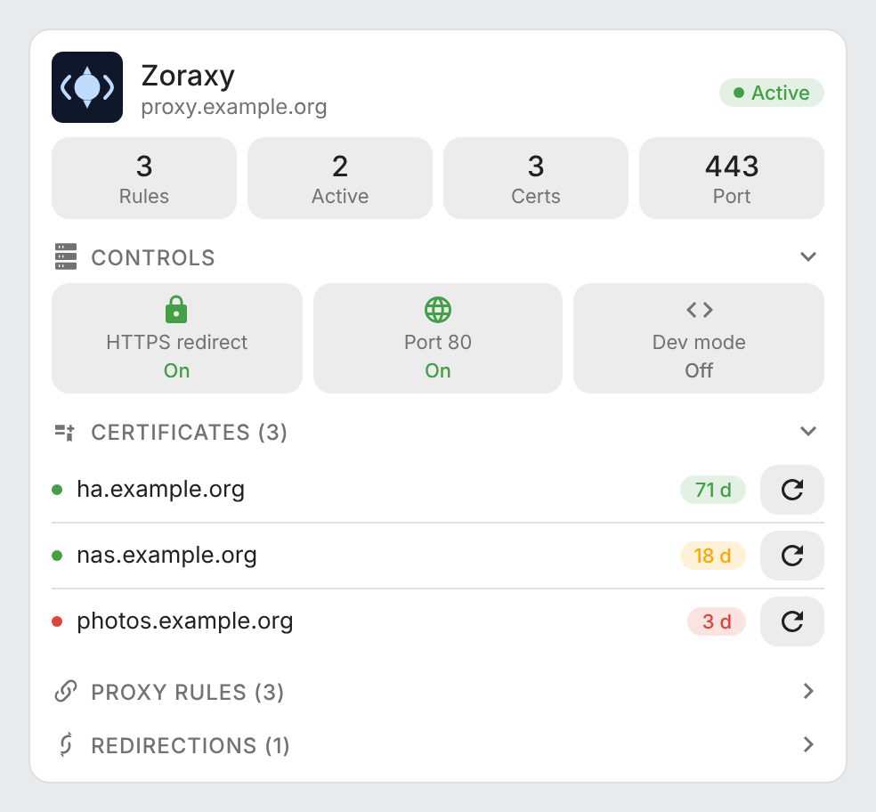
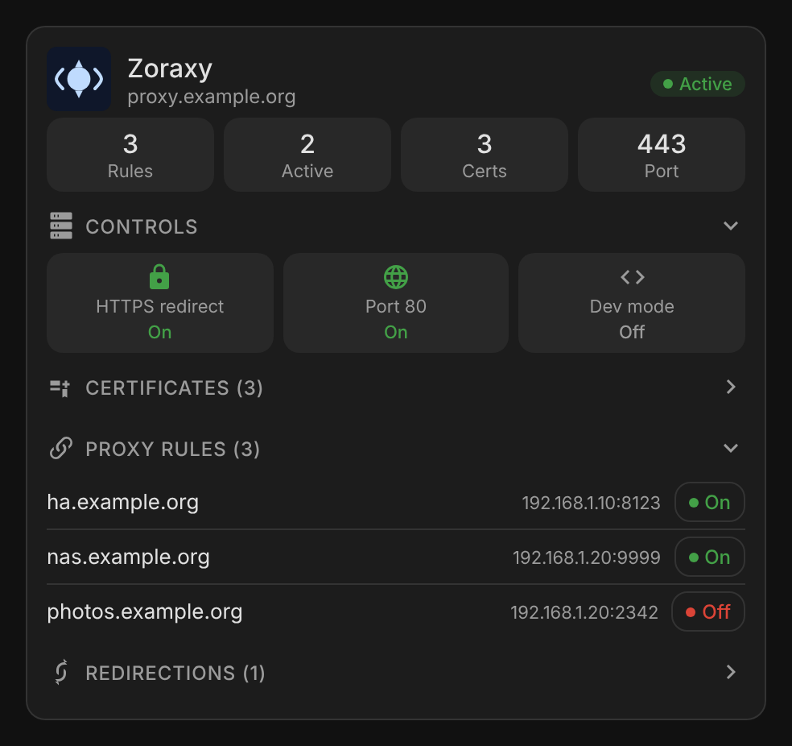

# ha-zoraxy

[](https://github.com/hacs/integration)
[](https://github.com/juju35/ha-zoraxy/actions/workflows/hacs.yml)
[](https://github.com/juju35/ha-zoraxy/actions/workflows/validate.yml)
[](https://github.com/juju35/ha-zoraxy/releases/latest)
[](LICENSE)

Home Assistant integration and Lovelace card for the [Zoraxy](https://github.com/tobychui/zoraxy) reverse proxy (v3.3.2+): proxy status, controls, TLS certificates with ACME renewal, and proxy rules you can switch on and off from the dashboard.

[](https://my.home-assistant.io/redirect/hacs_repository/?owner=juju35&repository=ha-zoraxy&category=integration)


## Features

- Sensors for proxy rules, active rules, TLS certificates, access rules and the inbound port
- One expiry sensor, one "expiring soon" binary sensor and one ACME renewal button per certificate, created dynamically
- Switches for the HTTPS redirect, the port 80 listener and the development mode
- A `zoraxy.toggle_proxy_rule` service to enable or disable a proxy rule from an automation
- A Lovelace card, shipped with the integration and registered automatically:
  - proxy status and key metrics
  - direct controls (HTTPS redirect, port 80, dev mode)
  - certificates with days left and a renewal button
  - proxy rules with an on/off button per rule, and HTTP redirects
- Visual editor for the card, light and dark mode, English and French
- Automatic reconnection when the Zoraxy session expires (about one hour)

## Prerequisites

- Home Assistant **2024.12** or later
- Zoraxy **v3.3.2** or later, and an account on its web interface

## Installation

### Via HACS (recommended)

Click the button below to add the repository directly:

[](https://my.home-assistant.io/redirect/hacs_repository/?owner=juju35&repository=ha-zoraxy&category=integration)

Then click **Download** and restart Home Assistant.

Or manually:

1. Open HACS → **⋮** (top right) → **Custom repositories**
2. Add `https://github.com/juju35/ha-zoraxy` — Type: **Integration**
3. Search for **Zoraxy** and click **Download**
4. Restart Home Assistant

### Manual

1. Copy `custom_components/zoraxy/` from the [latest release](https://github.com/juju35/ha-zoraxy/releases/latest) to `/config/custom_components/zoraxy/`
2. Restart Home Assistant

The card `zoraxy-card.js` is part of the integration: it is served at `/zoraxy/zoraxy-card.js` and added to the dashboard resources at startup (nothing is written to `/config/www/`). If the automatic registration fails, add it in **Settings → Dashboards → ⋮ → Resources**:
- URL: `/zoraxy/zoraxy-card.js`
- Type: **JavaScript Module**

## Configuration

### Integration

**Settings → Devices & services → Add integration → Zoraxy**, then fill in:

| Field | Example |
|---|---|
| Address | `http://zoraxy.local:8000` |
| Username / Password | Your Zoraxy credentials |
| Refresh interval | `30` seconds (10 minimum) |
| Verify the TLS certificate | On by default; turn it off only for an `https://` address with a self-signed certificate |

The refresh interval and the TLS verification can be changed later with **Configure** on the integration. When Zoraxy refuses the password, Home Assistant asks for the new one in **Settings → Devices & services**. Entries created with version 1.5.0 or earlier keep the TLS verification off, as before; turn it on in the options if your certificate is valid.

### Card

Edit a dashboard, click **Add card** and search for **Zoraxy Card**. Set the Zoraxy URL (opened when clicking the card title) and, if needed, the entity prefix. Or in YAML:

```yaml
type: custom:zoraxy-card
zoraxy_url: http://zoraxy.local:8000
```

| Option | Default | Description |
|---|---|---|
| `zoraxy_url` | — | Zoraxy web interface (`http://` or `https://`), opened from the card title and shown under it |
| `entity_prefix` | `zoraxy_reverse_proxy_zoraxy` | Common part of the entity ids |

### Entities

| Entity | Description |
|---|---|
| `sensor.*_regles_proxy` | Number of proxy rules (rules and redirects as attributes) |
| `sensor.*_regles_actives` | Active proxy rules |
| `sensor.*_certificats_tls` | Number of TLS certificates |
| `sensor.*_regles_d_acces` | Number of access rules |
| `sensor.*_port_entrant` | Proxy listening port |
| `sensor.*_cert_{domain}` | Certificate expiry date |
| `binary_sensor.*_cert_expirant_{domain}` | `on` when the certificate expires in less than 30 days |
| `button.*_renouveler_{domain}` | Triggers the ACME renewal |
| `binary_sensor.*_proxy_actif` | Proxy running |
| `binary_sensor.*_tls_active` | TLS enabled |
| `binary_sensor.*_redirection_https` | HTTP → HTTPS redirect |
| `binary_sensor.*_ecoute_port_80` | Listening on port 80 |
| `binary_sensor.*_mode_developpement` | Development mode (no cache) |
| `switch.*_redirection_https` | Turns the HTTPS redirect on or off |
| `switch.*_ecoute_port_80` | Turns the port 80 listener on or off |
| `switch.*_mode_developpement` | Turns the development mode on or off |

Names follow the Home Assistant language (English or French) under the **Zoraxy Reverse Proxy** device. The entity ids keep their historical French suffixes so existing dashboards and automations keep working; on a new install they start with `zoraxy_reverse_proxy_zoraxy_`, the card's default prefix.

### Service `zoraxy.toggle_proxy_rule`

| Parameter | Type | Required | Description |
|---|---|---|---|
| `domain` | `string` | yes | Domain of the rule (e.g. `myapp.example.com`) |
| `enable` | `boolean` | no | `true` to enable, `false` to disable; left out, the rule is toggled |

The action fails (and the card's button goes back) when the rule is not found or Zoraxy refuses the change. With several Zoraxy instances, the rule is looked up in all of them.

```yaml
action: zoraxy.toggle_proxy_rule
data:
  domain: myapp.example.com
  enable: false
```

## Screenshots

| Light (certificates open) | Dark (proxy rules open) |
|---|---|
|  |  |

## How it works

The integration logs in to the Zoraxy web API, polls it at the refresh interval and logs in again when the session expires. Certificate entities are created as certificates appear in Zoraxy.

On the card, the button next to each proxy rule calls `zoraxy.toggle_proxy_rule`; the button updates at once and the card refreshes when the integration has polled Zoraxy again. Certificates turn orange under 30 days and red under 7 days.

To debug:

```yaml
logger:
  logs:
    custom_components.zoraxy: debug
```

## Development

```bash
pip install playwright && playwright install chromium
python scripts/screenshots.py   # renders the card with mock entities into screenshots/
```

### Releasing

1. Bump the version in `custom_components/zoraxy/manifest.json` and `ZORAXY_CARD_VERSION` in the card
2. Add a `## <version>` section at the top of [CHANGELOG.md](CHANGELOG.md)
3. Push to `main`: the **Release** workflow creates the tag and the GitHub release with the changelog section as notes

## Translations

The integration and the card follow the language of Home Assistant. Currently supported:

| Language | Code |
|---|---|
| English | `en` |
| Français | `fr` |

Contributions for additional languages are welcome!

## License

[MIT](LICENSE)
